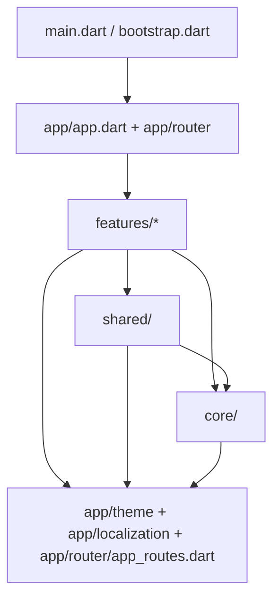

# Architecture

DORY uses **Clean Architecture** with a **feature-first** folder structure,
**Riverpod** for state management and dependency injection, and **GoRouter**
for navigation.

## Layers

Each feature in `lib/features/<feature>/` is split into three layers:

| Layer | Contains | May depend on |
|---|---|---|
| `presentation/` | Pages, widgets, Riverpod controllers (Notifiers) | `domain/`, core, shared, app foundation |
| `domain/` | Entities, repository **interfaces**, use cases. Pure Dart, no Flutter. | `shared/models`, `shared/enums` |
| `data/` | Repository implementations, data sources (API, cache), DTOs and mappers | `domain/`, `core/` (network, storage) |

Rules (enforced in review):

1. Widgets contain no business logic. They render state and forward user
   intent to controllers.
2. Presentation depends on repository **abstractions** from `domain/`, never on
   `data/` classes. Concrete implementations are bound in Riverpod providers.
3. Data sources (remote API, local cache) are isolated behind repositories.
4. Features never import another feature's `data/` or `presentation/`. If two
   features need the same thing, it moves to `shared/` or `core/`.
5. No giant files: split a widget once it does more than one job.

Phase 01 has no data yet, so features contain only `presentation/`. Empty
`data/` and `domain/` folders (with `.gitkeep`) mark where that code will live.

## Module dependency rules



- **Foundation** (`app/theme`, `app/localization`, `app/router/app_routes.dart`)
  holds design tokens, translations, and route names. Everything may import it.
- **Composition root** (`app/app.dart`, `app/router/app_router.dart`,
  `bootstrap.dart`) wires features together. Nothing imports it except `main`
  and tests.
- **`core/`** holds technical infrastructure (storage, errors, constants) and
  the design-system widgets. It never imports features.
- **`shared/`** holds cross-feature product code: role and category enums,
  shared models, and composite components such as the language picker.

All imports inside `lib/` are package imports (`package:dory_app/...`),
enforced by the `always_use_package_imports` lint.

## Startup

```
main() → bootstrap()
  ├─ WidgetsFlutterBinding.ensureInitialized()
  ├─ install global error handlers (FlutterError.onError, PlatformDispatcher.onError)
  ├─ register the bundled font license
  ├─ open persistent storage (falls back to in-memory storage on failure)
  └─ runApp(ProviderScope(overrides: [storage], child: DoryApp()))
```

Dependencies that need async initialization are created in `bootstrap()` and
injected with `ProviderScope` overrides. Their providers throw a descriptive
`StateError` if read without an override, so a missing override fails loudly.

## State management and dependency injection (Riverpod 3)

- `Provider` for services and singletons (`keyValueStorageProvider`,
  `appRouterProvider`).
- `NotifierProvider` for mutable state with intent methods
  (`languageControllerProvider`).
- Tests replace dependencies with `ProviderContainer.test(overrides: ...)`.
  See `test/helpers/test_app.dart`.

**Decision: no code generation (yet).** Providers and JSON mapping are
hand-written (`core/network/json.dart` typed readers), which avoids a
build_runner step and keeps parsing strict-cast safe. Re-evaluate
`freezed`/`riverpod_generator` when the models grow (queues, tickets).

- `FutureProvider.autoDispose.family` per resource (`businessProvider`,
  `branchesProvider`, ...); they watch the signed-in user's id, so a new
  session never sees the previous user's data.
- `AuthController` (Notifier) owns the session; `OnboardingController`
  (autoDispose Notifier) owns the onboarding draft.

## Navigation (GoRouter 18)

- Route locations are constants in `AppRoutes`. Navigating with string
  literals is not allowed.
- `/welcome/login` and `/welcome/register` are **children** of `/welcome`, so
  the back button always returns to welcome, including after a deep link.
- Each workspace is a `StatefulShellRoute.indexedStack`, so every tab keeps its
  own navigation stack. `WorkspaceShell` renders a bottom `NavigationBar` on
  compact windows (< 600dp) and a `NavigationRail` on wider ones. The rail sits
  on the right in Arabic.
- Unknown locations render `NotFoundPage`.
- Routes are built fresh per `GoRouter` instance, because shell branches own
  navigator `GlobalKey`s that must not be shared.

**Access control (Phase 03).** A top-level `redirect` (`auth_redirect.dart`)
reads the session from `AuthController` and is re-evaluated on every session
change (`refreshListenable`). The business workspace needs a signed-in user
(restoring → splash, signed out → login, both with `?from=`); welcome, login
and registration send signed-in users home. Business-scoped permissions come
from the API (`permissions` in responses), not from client-side roles. See
[FLUTTER_API_INTEGRATION.md](FLUTTER_API_INTEGRATION.md).

## Roles and workspaces

```dart
enum UserRole { customer, businessOwner, branchManager, employee, superAdmin }
enum AppWorkspace { customer, business, administration }
```

- Each `UserRole` maps to one `AppWorkspace`.
- A user holds a `Set<UserRole>`. `availableWorkspaces` and `canAccess` derive
  what the user can open, so being both a customer and a business owner works
  naturally.
- The active workspace is the shell the user is in (`/customer/...` or
  `/business/...`), and they switch from the Account tab.
- Business-scoped roles (owner, manager, employee) are granted **per
  business and branch** by the backend (`BusinessRole`, memberships in
  `/auth/me`). Which actions a screen offers follows the server's
  `permissions` hints; the server re-checks every request.

## Error handling

- `ErrorReporter.report()` (`core/errors/`) is the single reporting entry
  point. It logs today, and a crash-reporting service plugs in there later.
- Uncaught framework and async errors are routed to it by `bootstrap()`.
- Recoverable failures are handled where they occur and reported, for example
  storage that cannot be opened at startup, or a language preference that
  fails to save. They are never swallowed silently.

## Key decisions

| # | Decision | Why |
|---|---|---|
| 1 | Import `package:material_ui/material_ui.dart`, not `package:flutter/material.dart` | Material is being decoupled from the Flutter framework. go_router 18 is built on `material_ui`, whose `MaterialApp` is a **different class** from the framework's. Mixing the two silently breaks go_router's app detection and Material page transitions. |
| 2 | Compose localization delegates by hand (`AppLocales.delegates`) | gen-l10n's generated `localizationsDelegates` still points at the framework's legacy Material localizations, which `material_ui` widgets cannot see. |
| 3 | `KeyValueStorage` abstraction over shared_preferences | Testable without platform channels, swappable, and has a safe in-memory fallback. Uses the non-legacy `SharedPreferencesWithCache` API with a key allow-list. |
| 4 | Bundle the font instead of using `google_fonts` | Works offline, needs no runtime network fetch, has no privacy implications, and renders deterministically. (`google_fonts` 9 also needs Flutter 3.47.) |
| 5 | Light theme only | Keeps Phase 01 focused. All widgets read `Theme.of(context)`, so a dark theme can be added later without touching widgets. |
| 6 | Defer Dio, Freezed, json_serializable, secure storage, flutter_map | No code in Phase 01 uses them. See the dependency policy in [DEVELOPMENT_GUIDE.md](DEVELOPMENT_GUIDE.md#dependency-policy). |
| 7 | No placeholder data | Empty states and "no data" metric tiles are shown instead of invented numbers or businesses. |
